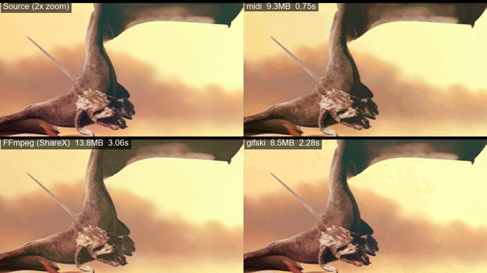
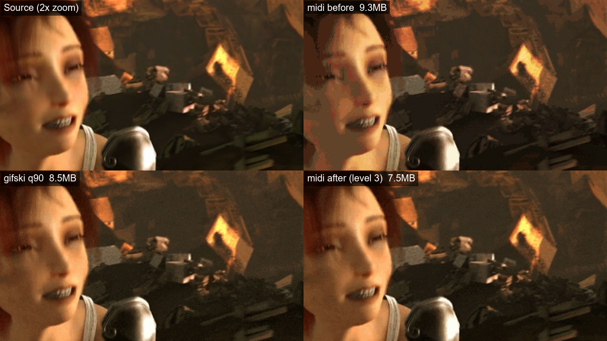
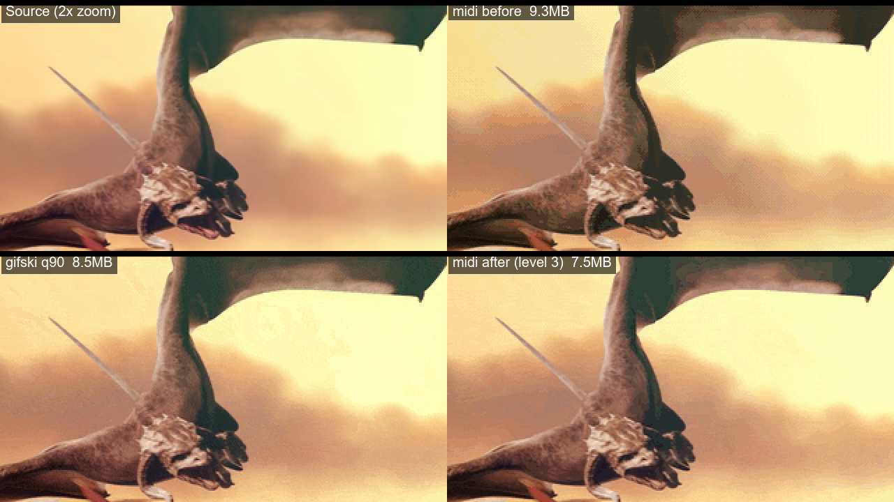

# midi — 포트폴리오 정리 (초안)

> 모든 수치는 이 저장소의 커밋 메시지와 `docs/gif-capture-design.md`에 기록된 측정값입니다. 측정 환경은 개발자 PC 한 대입니다.

## 한 줄 소개

화면의 원하는 영역을 단축키 하나로 녹화해 GIF로 저장하는 Windows 트레이 앱. GIF 인코더(팔레트, 디더링, LZW, 프레임 차분, 용량 목표 탐색)를 외부 라이브러리 없이 Rust로 직접 구현.

**기간** 2026-11-20 ~ 11-24 (작업일 4일) · **스택** Rust, Tauri 2, Win32 / DXGI Desktop Duplication, HTML·CSS·JS · **형태** 1인 개발 + AI 코딩 에이전트(Claude Code)

## 규모

2026-11-27, PR 4 기준.

| 항목 | 값 |
|---|---|
| 커밋 / PR | 97개 / 4개 |
| 코드 | Rust 9,920줄, 웹 UI 866줄 |
| 테스트 | 335개: 자동 실행 302개(모두 통과) + 실제 화면이 필요해 따로 실행하는 캡처 테스트 33개 |
| 크레이트 구조 | `gif-core`(플랫폼 무관 인코더·상태 머신) / `gif-win`(Win32·DXGI) / `app`(Tauri) |
| 설계 문서 | 875줄 (설계, 결정 기록, 경쟁 도구 조사) |
| 배포 | NSIS 설치 파일, 관리자 권한 없이 사용자 단위 설치 |

## 핵심 성과 (수치)

### 1. 인코딩 속도: 측정 → 병목 제거 반복

먼저 단계별 시간을 재는 예제를 만들고(디더링의 색 탐색이 전체의 90%), 병목을 하나씩 바꿨습니다.

| 클립 | 처음 | 최종 | 배수 |
|---|---|---|---|
| 2400×1400, 106프레임 | 136초 | 13초 | **약 10배** |
| 640×360, 매 프레임 색 변화 | 16.6초 | 2.6초 | **약 6.4배** |
| 1280×720, 색 적음 | 2.2초 | 0.9초 | 약 2.4배 |

주요 단계:
- 가까운 팔레트 색 찾기: 매번 255색 전체 탐색 → 1,677만 칸 캐시 표 → 초록 채널 정렬 탐색 → RGB 16³ 셀별 후보 목록. 디더링 **약 120초 → 3초 미만**
- 색 세기: HashMap → RGB 직접 인덱싱 표. **7.7초 → 0.5초**
- Median cut 중앙값: 전체 정렬 → 채널 값 카운팅. 팔레트 생성 **4.0초 → 0.55초**
- LZW 사전: HashMap → 4096×256 고정 표. 압축 **1.47초 → 0.71초**
- 변경 사각형: 프레임 4회 순회 → 1회. 차분+압축 **1.98초 → 0.86초**

**모든 최적화에서 출력 GIF가 바이트 단위로 동일**함을 확인했고, 색 탐색은 1,677만 색 전부를 전수 탐색 결과와 대조했습니다(7개 팔레트). 이 과정에서 기존 단위 테스트로는 안 잡히던 셀 경계 13색 오류를 찾아 테스트로 고정.

### 2. 메모리

| 항목 | 처음 | 최종 |
|---|---|---|
| 팔레트 생성 최고 메모리 (640×360) | 1,064MB | **160MB (−85%)** |
| 인코더 최고 메모리 (2400×1400, 106프레임) | 2.5GB | 1.2GB |
| 녹화 저장 방식 | 메모리, 최대 1GiB | 디스크 스풀, 길이가 메모리와 무관 |
| 실제 앱 메모리 | — | 대기 6MB, 녹화 중 75~79MB로 길이와 무관하게 일정 |

### 3. 디스크·파일 크기

- 바뀐 줄만 쓰는 스풀: 전체 화면 30fps 900프레임 **10GB → 2.2GB (−78%)**, 프레임 누락 없이 캡처
- 프레임 간 미세 색 변화 무시(tolerance): 480×270 3초 클립 **272KB → 124KB(−55%) / 78KB(−71%)**
- 용량 목표 모드: 10단계 화질 사다리를 이분 탐색, **최대 6회 인코딩**으로 목표 용량 충족. 실측: 10초 녹화를 2MB 목표로 1.68MB에 맞춤

### 4. 품질 검증

- 설치판으로 PC 앞에서 7개 시나리오 점검 → **7/7 통과**, 그 과정에서 버그 2개(다중 모니터 이동, 테두리 다시 그리기) 발견·수정 후 재확인
- 실측: 12.6초 녹화 Enter 후 약 1초 만에 저장, 189프레임 중 152프레임이 변경 영역만 담김
- 엣지 케이스 처리: 세로로 돌린 모니터, 다중 모니터, 단축키 충돌, 원격 데스크톱 실패 안내, DRM 영상(검은 화면) 안내, 녹화 시작 0.3~0.6초 사이의 취소, 프레임 지연 누적 보정(30fps → 3,3,4)

## 기존 도구와의 비교

### 같은 클립 인코딩 벤치마크 (2026-11-24 측정)

**조건**
- 원본: Blender Foundation의 Sintel 예고편(CC-BY 3.0). lanczos로 축소하고 15fps로 맞춘 같은 RGB 프레임을 모든 인코더에 넣음(gifski에는 같은 픽셀을 PNG로)
- 환경: Ryzen 5 5600X(6코어 12스레드), Windows 10
- 시간: 프로세스 전체 실행 시간(입력 읽기 포함), 3회 측정의 중앙값
- 화질: GIF를 다시 풀어 원본과 비교한 SSIM(1에 가까울수록 좋음)과 PSNR(dB, 높을수록 좋음)
- 비교 대상
  - **FFmpeg 2-pass**: `palettegen=stats_mode=full` + `paletteuse=dither=sierra2_4a`. ShareX의 FFmpeg 경로 설정이고, ScreenToGif도 선택할 수 있는 인코더
  - **gifski 1.34**: 기본 화질(90). libimagequant 기반이고 화질로 가장 많이 쓰이는 GIF 인코더
  - **midi**: 앱 기본값(1단계: 255색, ordered dithering)
- ScreenToGif 자체 인코더는 GUI 전용이라 스크립트로 잴 수 없어 제외

| 클립 | 인코더 | 시간 | 용량 | SSIM | PSNR |
|---|---|---|---|---|---|
| 액션 640×360, 10초 150프레임 | **midi** | **0.75초** | 9.34MB | 0.829 | 35.2 |
| | FFmpeg | 3.06초 | 13.78MB | 0.899 | 34.7 |
| | gifski | 2.28초 | **8.45MB** | 0.856 | **37.8** |
| 설원 640×360, 6초 90프레임 | **midi** | **0.45초** | 4.92MB | 0.980 | 43.9 |
| | FFmpeg | 0.71초 | 6.37MB | **0.990** | **47.0** |
| | gifski | 1.08초 | **2.91MB** | 0.930 | 39.2 |
| 액션 1280×720, 10초 150프레임 | **midi** | **2.53초** | 31.53MB | 0.851 | 35.4 |
| | FFmpeg | 10.07초 | 49.44MB | 0.877 | 34.4 |
| | gifski | 7.95초 | **27.93MB** | **0.902** | **38.3** |

**CPU 사용량** (액션 640×360): midi는 CPU 0.72초로 코어 1개만 씀. FFmpeg는 3.39초(코어 1.1개), gifski는 15.66초(코어 7개).

**정리**
- **속도:** 세 클립 모두 midi가 가장 빠름. FFmpeg보다 1.6~4.0배, gifski보다 2.4~3.1배 빠름. gifski가 코어 7개를 쓰는 동안 midi는 1개만 쓰며, CPU 시간으로는 **약 22분의 1**
- **용량:** FFmpeg(ShareX 방식)보다 **23~36% 작음**
- **화질:** 움직임이 많은 영상에서는 gifski가 더 작은 파일로 더 좋은 화질을 냄(PSNR +2.6~2.9dB). midi의 위치 고정 디더링 무늬가 SSIM에서 불리하게 잡힘. 확대 비교에서는 FFmpeg가 색이 틀어지는 데 비해 midi는 색조를 지키지만, 그라데이션에 디더 무늬가 보임
- 결론(개선 전): midi는 속도와 CPU를 우선한 인코더였고, 화질은 gifski가 앞섬 → 아래 "화질 개선"에서 이 격차를 뒤집음

재현 자료: [portfolio/bench/](portfolio/bench/) (측정 스크립트, midi 측정 프로그램, 원본 결과 CSV. CSV에는 표에서 뺀 `midi-L2`(화질 2단계)와 실험용 FFmpeg 변형도 있음)

### 화질 개선: gifski를 같은 용량에서 앞서기 (2026-11-24)

**공정한 비교 기준부터 세움.** GIF 인코더는 용량과 화질을 맞바꾸므로 파일 하나씩 비교하면 의미가 없습니다. gifski를 화질 100~60의 6단계로 돌려 "용량-화질 곡선"을 만들고, midi 파일과 **같은 용량에서** gifski가 내는 화질을 곡선에서 읽어 차이를 계산하는 스크립트(`tools/gif-rate-quality.sh`)를 만들었습니다. 지표는 PSNR, SSIM, 그리고 **흐리게 한 뒤의 PSNR**(디더링을 끄면 PSNR·SSIM은 오르지만 그라데이션에 계단이 생기는데, 이 지표는 그걸 잡아냄) 세 가지입니다.

**원인 진단 → 가설 4개 → 하나씩 측정해 남기거나 버림**

| 단계 | 근거 | 같은 용량에서 gifski 대비 PSNR (평균) |
|---|---|---|
| 시작 | | **−2.87dB** |
| 팔레트를 median cut 대신 "오차가 가장 큰 상자를 오차가 가장 작게 자르기" + k-means 3회 | 색이 밀집한 곳에만 색을 쓰던 문제 | |
| 장면마다 팔레트 따로 (장면 전환 감지, GIF 지역 색상표) | 장면 1개짜리 클립은 midi가 이미 이김 → 6개 장면이 팔레트 하나를 나눠 쓰는 게 원인. 장면을 따로 인코딩해 +1.27dB를 미리 확인 | −1.49dB |
| 손실 LZW (압축할 때 허용 오차 안의 색으로 이어 붙이기) + 화질 단계를 "색 줄이기" 대신 "손실 늘리기"로 재설계 | 색 수를 줄여 용량을 줄이는 단계에서 격차가 가장 큼 | +0.24dB |
| 디더링을 "가장 가까운 두 색을 비율대로 섞기"로 교체 (위치 고정 유지) | 전역 디더 세기가 새 팔레트에서 과하게 걸림 | **+2.12dB** |

**결과** (화질 단계 1~5 × 액션 클립 2개, 평균): 같은 용량에서 gifski 대비 **PSNR +2.12dB, SSIM +0.044, 흐린 PSNR +1.96dB**. 세 지표 모두 앞섬.

| 액션 640×360 | 시간 | 용량 | PSNR | SSIM |
|---|---|---|---|---|
| midi 개선 전 (1단계) | 0.75초 | 9.34MB | 35.2 | 0.829 |
| gifski 화질 90 (기본) | 2.28초 | 8.45MB | 37.8 | 0.856 |
| **midi 개선 후 (3단계)** | **1.57초** | **7.52MB** | **38.8** | **0.920** |
| gifski 화질 100 | — | 13.56MB | 41.3 | 0.966 |
| **midi 개선 후 (1단계, 기본)** | **1.43초** | **11.13MB** | **41.3** | **0.971** |

- gifski 기본값보다 **파일 11% 작고, PSNR +1.0dB, SSIM +0.06, 1.45배 빠름**(코어 1개 vs 7개)
- 1280×720에서도 1단계 3.74초 vs gifski 7.95초
- 대가: midi 자신은 개선 전보다 약 1.9배 느려짐(0.75초 → 1.43초). 그래도 gifski보다 빠름
- 자동 실행 테스트 283개 → 302개, 모두 통과. 장면이 하나뿐인 클립은 장면 분리 전후 출력이 바이트 단위로 같음을 확인

개선 전에는 얼굴이 계단처럼 뭉개졌는데(오른쪽 위), 개선 후(오른쪽 아래)에는 gifski(왼쪽 아래)와 비슷하게 부드럽고 파일은 더 작습니다.

재현 자료: `tools/gif-quality.sh`, `tools/gif-rate-quality.sh`, 결과 [portfolio/bench/rate-quality-after.csv](portfolio/bench/rate-quality-after.csv)

### 기능·설계 비교

> 설계 전에 ScreenToGif(C#/WPF), ShareX(C#), LICEcap의 소스를 직접 읽고 방식을 비교했습니다(`docs/gif-capture-design.md` §7).

| 항목 | 기존 도구 | midi |
|---|---|---|
| GIF 인코더 | gifski(AGPL), gifsicle(GPL), ShareX(GPL), FFmpeg 등 카피레프트 라이선스가 대부분 | **직접 구현** → 라이선스 제약 없음 |
| 화면 읽기 | ScreenToGif 기본값과 LICEcap은 BitBlt(GDI) | DXGI Desktop Duplication(GPU) |
| 영역 선택 화면 | 두 도구 모두 기본은 멈춘 스크린샷 | 재생 중인 영상 위에서 바로 선택 (영상 일부 녹화 용도) |
| 테두리·조작 패널 | ScreenToGif는 캡처 제외(`WDA_EXCLUDEFROMCAPTURE`)를 쓰지 않고 위치로만 피함 | 캡처 제외 + 포커스 안 뺏음 → 영역과 겹쳐도 GIF에 안 찍히고, 전체 화면 플레이어가 안 풀림 |
| 세로로 돌린 모니터 | ScreenToGif 알려진 문제(프레임이 돌아간 채 나옴) | 회전을 읽어 보정, 실기로 확인 |
| 용량 목표 | (ezgif 같은 웹 도구에 있음) | 데스크톱 앱 안에서 최대 6번 인코딩으로 목표 용량 충족 |

ShareX·ScreenToGif가 기능은 훨씬 많습니다. "더 낫다"가 아니라 **영상 일부를 GIF로 뜨는 용도에 맞게 다르게 고른 점**으로 설명하는 게 맞습니다.

## AI 활용 방식

> 97개 커밋 중 94개가 AI 공동 작성으로 기록돼 있습니다. 숨기기보다 "어떻게 썼는지"를 보여 주는 편이 낫습니다.

**내가 한 일 (판단·방향·검증)**
- 제품 방향 설정: 단순 캡처 도구 → ezgif 같은 범용 GIF 편집기를 최종 목표로 전환
- 스택 결정: AI 종합 추천은 C#/WPF였지만, 배포 크기(런타임 없는 작은 exe)와 확장성을 보고 **Rust + Tauri 2로 직접 결정**
- 설계 선택: 설정 화면 시안 4개 중 "위 결과·아래 설정" 선택
- 실기 검증: PC 앞 7개 시나리오 직접 수행, 버그 2개 발견, 기능 요청(막대에서 가로·세로 직접 입력)

**AI를 다루는 방법**
- **여러 모델 경쟁 + 교차 심사**: 스택 제안서를 4개 모델(Opus, Fable, Sonnet, Haiku)이 각자 쓰고, 다른 모델이 5개 기준으로 교차 채점한 뒤 가장 나은 안을 기준으로 다른 안의 장점을 합침. UI 시안도 같은 방식
- **측정 기반 최적화 지시**: "빠르게 해 줘"가 아니라 단계별 시간 측정 → 병목 하나씩 → 결과가 바이트 동일한지 확인하는 루프로 진행
- **병렬 실험과 검증**: 화질 개선은 서로 다른 파일을 건드리는 가설 3~4개를 AI 에이전트에 각각 독립된 작업 공간에서 동시에 맡기고, 돌아온 결과를 직접 다시 측정해 재현될 때만 합침. 지표가 왜곡될 수 있는 지점(디더링을 끄면 PSNR이 오르는 문제, 파일 하나씩 비교하는 문제)을 먼저 찾아 측정 기준을 고친 뒤 진행
- **결정 기록 문서화**: 설계 문서에 결정과 근거, 측정값, 미결 사항을 남겨 세션이 바뀌어도 맥락 유지
- **검증 장치**: 레이아웃이 720×600에 맞는지 자동 확인 스크립트, 실제 화면이 필요한 테스트 분리, PR 단위 리뷰

## 이력서용 짧은 버전

- Rust로 GIF 인코더(오차 기반 팔레트 분할 + k-means, 위치 고정 디더링, 손실 LZW, 프레임 차분)를 외부 라이브러리 없이 구현한 Windows 화면 녹화 앱 개발 (Tauri 2, DXGI)
- 프로파일링 기반 최적화로 인코딩 시간 136초 → 13초(약 10배), 팔레트 메모리 1,064MB → 160MB(−85%), 출력은 바이트 단위 동일 유지
- 같은 용량에서 gifski보다 화질이 높은 GIF 인코더로 개선: 같은 용량 기준 PSNR −2.87dB → +2.12dB. gifski 기본값보다 파일 11% 작고 PSNR +1.0dB, 1.45배 빠름(코어 1개)
- 공정 비교를 위해 용량-화질 곡선 기반 측정 도구를 먼저 만들고, 원인 진단 → 가설 4개(장면별 팔레트, 오차 기반 팔레트, 손실 LZW, 2색 혼합 디더링)를 하나씩 측정해 채택
- 변경 줄만 기록하는 디스크 스풀로 녹화 임시 데이터 10GB → 2.2GB(−78%), 앱 메모리를 녹화 길이와 무관하게 80MB 이하로 유지
- 용량 목표 모드: 10단계 화질을 이분 탐색해 최대 6회 인코딩으로 목표 용량 충족
- AI 코딩 에이전트로 4일간 97커밋·테스트 335개 규모 구현. 다중 모델 경쟁·교차 심사로 설계안 선정, 측정과 실기 점검(7/7)으로 검증

## 면접 대비 (꼭 설명할 수 있어야 할 것)

AI가 코드를 많이 썼기 때문에, 아래는 직접 설명할 수 있게 준비해 두는 편이 안전합니다.
- 오차 확산(Floyd–Steinberg) 대신 위치 고정 디더링을 기본으로 한 이유 (프레임 간 노이즈 → 차분 무력화 → 용량 증가)
- 셀별 후보 목록이 전수 탐색과 같은 답을 내는 이유 (가장 먼 점 거리 기준, 동률 포함)
- 용량 목표 이분 탐색의 전제 (낮은 단계가 더 큰 파일을 내지 않는다)
- 핫키를 "현재 상태 → 있어야 할 핫키 집합" 순수 함수로 맞추는 이유 (어느 경로로 나가도 해제, 표 테스트 가능)
- 왜 WPF 추천을 거절하고 Tauri를 골랐는지
- 벤치마크에서 gifski가 화질이 더 좋았던 이유와 midi가 더 빠른 이유, SSIM과 PSNR이 서로 다른 결론을 낼 때 어떻게 읽는지
- 왜 파일 하나씩이 아니라 "같은 용량에서" 비교해야 하는지, 흐린 PSNR을 왜 추가했는지
- 장면별 팔레트가 효과 있다는 걸 코드를 바꾸기 전에 어떻게 확인했는지 (장면을 따로 인코딩해 본 실험)
- 손실 LZW에서 "다음 프레임은 화면에 실제로 보이는 프레임과 비교해야 한다"는 점이 왜 중요한지
